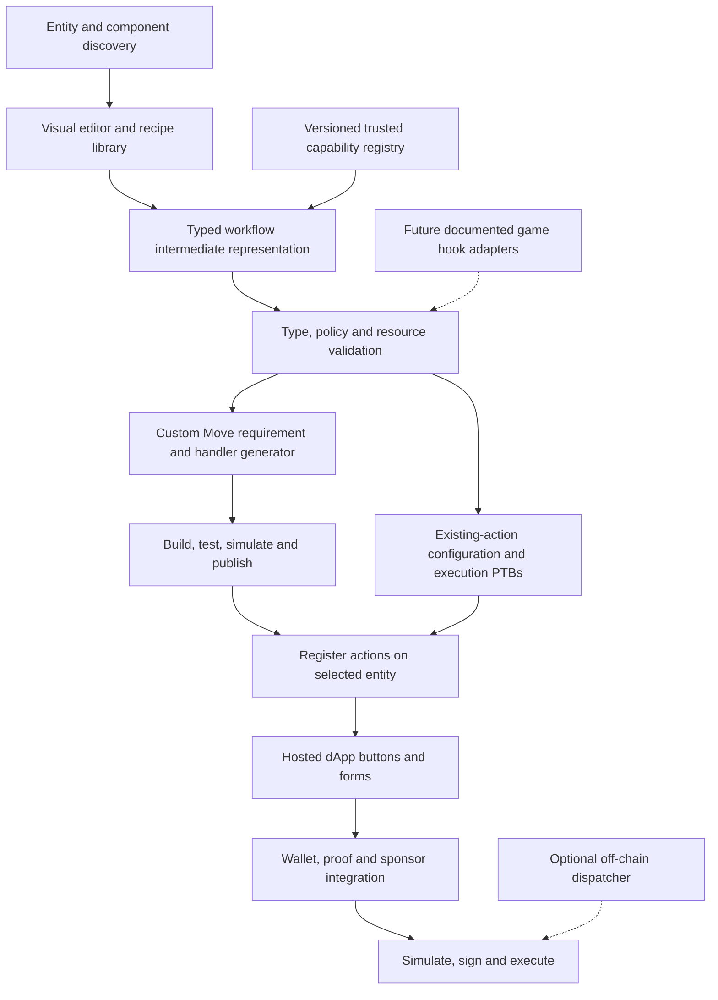

# Low-Code for EVE Frontier Builder Program — High-Level Design

**Status:** Proposed
**Evidence baseline:** `world-contracts/dev` at `d2027030ac168faa3da86dbaedd17c1f2d0a3845`.  
**Legacy comparison:** `world-contracts/main` at `d33ff232bd3878e8f9ad0721e18564b21facc925`.  
**Frontier Flow baseline:** `main` at `061e7c88387cb6605aec36a3c0e9ed11b8dbe1fe`.

This design supports the Builder Program's [low-code learning and enablement scope](scope.md#pillar-1--agentic-coding-and-low-code-for-eve-frontier). Claims about contracts are based on source inspection, not a fresh test run or verification of deployed bytecode. Branch names move; source references below are pinned to the inspected commits.

## 1. Purpose and goals

Enable a builder to experience mutating server behaviour in Frontier using three familiar building blocks:

1. **Triggers:** an explicit invocation that starts the workflow - this may be manual, i.e. a button; or it may be autonomous, i.e. `inProximity`.
2. **Logic/dataflow:** typed inputs, conditions, calculations, and policy checks.
3. **Outputs:** inventory operations, metadata changes, or responses to a supported game integration.

The builder should be able to select an entity, visually build a flow, simulate it, deploy it and use it in-game without writing Move for ordinary workflows. Advanced workflows can generate reviewed Move requirements and handlers. The intent is to activate builders who don't initially want to write Move, by opening up custom server-side code with a familiar drag-drop interface (see: Power Automate, Logic Apps, n8n, IFTTT, etc.).

The platform should produce both:

- **On-chain behaviour:** Generated extension packages.
- **An interaction surface:** a simple hosted dApp with buttons for each interaction and forms to invoke those actions.

The initial goal is as a low-code interface to complete guided excercises not a complete engine for building any possible contract.

### Evidence labels

| Label | Meaning |
|---|---|
| **Implemented on dev** | Present in the pinned live v1 source or SDK. This does not establish production availability. |
| **Legacy main evidence** | Present in the pinned assembly-first implementation; useful precedent, not a v1 ABI. |
| **Proposed platform feature** | Something we intend to build in Flow. |
| **Expected future integration** | A capability we would like to support if the game and v1 contracts provide it; neither delivery nor interface is confirmed. |

## 2. Contract model: entities, not fixed assembly types

**Implemented on dev:** the foundation is `Entity → Component → Action → Request → Requirement`. An entity contains component state and named actions in dynamic fields. An action describes an ordered set of requirements; invoking it creates a transaction-scoped request that must be completely satisfied. [D1–D3]

Storage, character, and other game roles are compositions rather than separate base object types. Flow must therefore discover **installed capabilities**, rather than select a materializer solely from an assembly name.

| Entity composition | Available v1 surface | Initial Flow treatment |
|---|---|---|
| Any `Entity` | Component IDs, tenant/game key, action maps, access-cap reference, lifecycle | Discovery and action configuration/invocation |
| Character + `Identity` | Tribe ID and bound wallet address | Character selection and identity inputs; capability-based access |
| Structure + `Inventory` | Balances, capacity, deposit/withdraw, game/chain bridges | Storage, vending, and exchange recipes |
| Ship-like entity + `Inventory` | The same inventory behaviour | Cargo transfer/trading; not navigation or combat |
| Any entity + `Metadata` | Name, description, URL, programmable edit | Display and owner-restricted edit workflows |
| Any entity + `GenericModule` | Game type ID and opaque bytes | Read-only discovery initially; no inferred gameplay behaviour |
| Gate, turret, power/fuel fittings | No dedicated live v1 implementation in this baseline | Unsupported execution nodes until an adapter has a real ABI |

The inventory implementation and tests support multiple inventory components on one entity. Use `component_id` to select a slot; component names are optional, non-unique labels. The swap integration test explicitly represents ships using storage entities because a dedicated ship module does not yet exist. [D4, D9]

Entity/component creation and installation are admin-gated. Configuring an owner action requires its `AccessCap`. The player editor must not imply that an owner can freely install arbitrary game fittings. [D1, D7]

## 3. Triggers: what actually starts execution?

**Data is not a trigger.** Reading a tribe, inventory balance, or docking status does not initiate a transaction. Neither a Move event nor a passage of time automatically executes a contract.

For the initial v1 storage experience, the trigger is **manual invocation through a dApp button**. The intended product path is a web page associated with an assembly and opened in-game. Its button constructs a transaction and obtains the required signatures. As v1 progresses then additional assemblies can be integrated into the framework.

This in-game page-loading experience is a product integration assumption, not something proven by the Move contracts. v1 Metadata stores a URL, but the source does not establish that the game renders that URL as a dApp or exposes the necessary wallet/proof interfaces. Validate how assembly pages are attached and loaded before claiming end-to-end in-game support. [D5]

| Flow trigger | Status | Execution model |
|---|---|---|
| Button / form submission | **Proposed platform feature** over implemented action invocation | Player explicitly invokes a configured action and signs the transaction |
| External application / CLI invocation | **Implemented contract entry surface** | Another client builds the same supported transaction |
| Turret proximity / aggression behaviour | **Expected future integration**, with legacy main evidence | A documented game targeting integration explicitly invokes builder logic; no v1 interface yet |
| Gate jump eligibility | **Expected future integration**, with legacy main evidence | A documented gate integration checks builder policy or a permit; no v1 interface yet |

Do not connect the game's ordinary inventory controls to a Flow graph by implication. There is no established automatic storage callback in the inspected v1 source. All initial storage workflows require explicit invocation; background reactions require an off-chain dispatcher.

## 4. Expectations carried forward from main

### 4.1 Turrets: targeting evaluation, not autonomous event subscriptions

**Legacy main evidence:** the turret module documents `InProximity` and `Aggression` behaviour. Its documented integration calls `get_target_priority_list` when target behaviour changes, using the configured extension package when one is authorized. Candidate inputs include character/tribe, ship type/group, HP/shield/armor ratios, aggressor state, current weight, and a behaviour-change reason. The result is a target-priority list. [M1, M2]

**Expected future integration:** preserve the ability to visually filter and score candidates when a v1 game integration supplies an equivalent evaluation interface. Palette labels may include “In proximity” and “Aggression”, but they are conceptual triggers, not promised v1 function names or separate event subscriptions.

A turret graph should produce a targeting decision. It should not claim to fire weapons directly. The game remains responsible for acting on the supported result.

### 4.2 Gates: authorization/permit policy

**Legacy main evidence:** gates support extension authorization, `issue_jump_permit`, and `jump_with_permit`. Permits bind a character to a route and expiry; the default jump path rejects a configured extension. The tribe example checks policy before issuing a permit. [M3, M4]

**Expected future integration:** support a “Can jump?” policy graph if v1 provides a suitable gate interface. The actual adapter may issue/validate a permit rather than return a boolean. Do not describe `canJump` as an existing function, or assert that main provides an arbitrary automatic gate callback.

### 4.3 Migration boundaries

The inspected v1 baseline has no live turret, weapon, gate, or transport handler. Legacy `Gate`, `Turret`, `OwnerCap<T>`, `OnlineReceipt`, and `JumpPermit` types must not be copied into the v1 backend as if they were compatible.

Keep legacy and v1 targets separate. Reuse portable logic nodes, but require explicit adaptation and revalidation of graphs when the actual v1 hook contracts arrive.

## 5. Proposed platform architecture



### 5.1 Discovery and capability registry

Discover entities, installed component IDs/types/versions, and both owner/admin action maps. Dynamic-field inspection is needed: there is no general action-list getter in this baseline. Admin actions take precedence over owner actions with the same name; show the effective action and warn about shadowing. [D1]

Maintain a trusted registry for each supported requirement/component:

- Original type identity, callable package/version, and configuration BCS schema.
- Requirement constructor and execution handler.
- Input/output types and linear-resource rules.
- Access checks, docking/proof prerequisites, and sponsor requirements.
- Dynamically introduced requirements and supported versions.

The ADR proposes per-handler PTB templates, but no `*_template` functions exist in the live source inspected. Start with curated adapters backed by the SDK; do not assume automatic template discovery exists. [D3, D8]

Unknown components can be displayed read-only. Unknown requirements must block execution rather than be silently skipped or routed to untrusted handlers.

### 5.2 Typed graph and execution backends

Use an intermediate representation separating:

- **Invocation context:** selected entity, environment, actor, inputs.
- **Pure expressions:** booleans, numbers, lists, options, comparisons, calculations.
- **Enforced requirements:** owner/caller, item rules, custom policies.
- **Effects:** deposit, withdraw, bridge, metadata edit.
- **Resources:** requests, item results, caps, return receipts.

Use bigint internally and decimal strings in persisted graph documents for `u64` values. Define checked arithmetic, fixed-point scales where needed, and explicit division rounding. Do not use JavaScript floating-point arithmetic for authoritative quantities.

Support two v1 paths:

1. **Existing-contract path:** generate PTBs that construct requirements and register actions; no new Move package is needed for fixed inventory recipes.
2. **Custom-policy path:** generate a requirement type, constructor and handler in a builder-owned Move package when the existing requirements cannot enforce the policy.

Branching in a UI graph must lower to a valid ordered on-chain requirement flow. It is not permission to skip outstanding requirements. Critical predicates must be enforced by generated Move, not only by selecting different PTB calls in the browser.

### 5.3 SDK and environment integration

The checked-in SDK already provides action configuration/invocation, inventory operations, metadata editing, docking verification/attestation, sponsor checks, and capability borrowing. Reuse it rather than duplicate these transaction builders. [D8, D9]

Integration work remains:

- The SDK source package is version `0.0.0`; verify release availability and pin the exact supported source/dependency integrity.
- Root exports include Node filesystem-based preset/configuration helpers. Provide a browser-safe entry point or adapter and load manifests as data.
- v1 uses separate packages and environment-specific MVR names, such as `@evefrontier/world-core-dev`, rather than one legacy `world` package.
- Preserve original package IDs for persisted type identity and distinguish them from callable published package versions.
- Validate manifests, shared-object references, ABI compatibility, chain/environment, and compiler/toolchain support before execution.

The checked-in `deployments/dev/world.json` records core, character, currency, inventory and metadata packages. A manifest is deployment evidence, not proof that the current branch's complete ABI is deployed or that game APIs are available. [D10]

### 5.4 Hosted interaction page

Generate a dApp from each published workflow's input schema. Show action description, input bounds, required access, expected inventory movements, and the transaction being signed.

The page connects to the supported wallet and obtains signing proof or sponsored attestation through an approved integration. Flow must not hold player keys or grant itself game-minting/sponsor authority.

Expose portable URL delivered via Walrus, then document how an owner associates that page with an assembly once the supported game mechanism is confirmed. Treat page hosting and wallet integration as separate from publishing an on-chain action.

## 6. Transaction lifecycle and safety

### Configuration

```text
Select entity and inventory slot
→ Construct ordered requirements
→ Construct Action
→ enable_action
→ Verify owner AccessCap
→ complete_request
→ Return any borrowed cap
```

### Invocation

```text
Obtain signing proof or authorized attestation, if needed
→ Borrow required cap, if object-owned
→ interact(action name)
→ Satisfy each requirement in execution order
→ Consume follow-up requirements
→ complete_request
→ Consume/route item results and return borrowed caps
```

The compiler must enforce these invariants:

| Constraint | Evidence and design response |
|---|---|
| Every request completes | `Request` has no abilities; `complete_request` requires zero outstanding requirements. Track it as a linear resource. [D1, D2] |
| No overlapping interactions on one entity | An interaction locks its entity. Complete before another interaction on that entity. [D1] |
| Component identity is authoritative | Handlers target the next requirement's component ID, not a display name. [D1, D4] |
| Owner configuration is not owner-only execution | Require an explicit execution policy. Warn on unrestricted withdrawals or edits. [D4, D5, D7] |
| A caller cap is identification, not ownership of the target | `Caller` accepts any valid cap and records its entity ID; do not label it “is owner”. [D7] |
| Deposit/withdraw need docking | Checks happen inline and do not appear as explicit action requirements. Establish docking before these handlers. [D4, D6] |
| One docking establishment per transaction | Current scratchpad rejects a second docking. Split multi-stop logistics into separate transactions. [D6] |
| Bridges introduce sponsor checks | Bridge handlers enqueue `Sponsor`; adapters must discharge it in the resulting order. Do not assume an admin is automatically a sponsor. [D4, D7] |
| Borrowed caps must be accounted for | Borrowing creates a non-droppable return receipt. Initially generate borrow-and-return flows. [D7, D9] |
| Item results must be accounted for | Route withdrawal results into a supported deposit/transfer; validate Move abilities and ownership. [D4] |
| Admin actions can shadow owner actions | Show which map resolves; re-read effective configuration before signing. [D1] |
| Action removal is not reversible soft-disable | Current `disable_action` removes the entry. Replacement needs authorized removal and re-registration. [D1] |

Custom requirements must preserve the type-driven permit model and use named errors. Identity policies must bind the supplied Identity entity to the verified actor; trusting a caller-supplied tribe number is insufficient. Critical inventory conditions must be checked in the same transaction as the mutation.

A formula such as “input × price = output” is not enforced merely because the dApp calculated it. A custom policy must bind and constrain the actual quantities consumed by downstream handlers. Likewise, a reserve rule must constrain the post-withdrawal balance, not just observe the pre-withdrawal balance. These require reviewed lowering strategies and adversarial tests.

## 7. Logical operations catalogue

These are proposed logic/dataflow nodes, **not triggers or outputs**. “Generated Move” describes the implementation we intend to build, not an existing standalone v1 API. “Custom requirement” means a generated on-chain requirement/handler enforces the policy. Existing checks generally abort on failure rather than return booleans.

| Category | Operation | Inputs → Result | Example use | Implementation |
|---|---|---|---|---|
| Boolean | AND | Two booleans → boolean | Owner policy and sufficient stock | Generated Move expression |
| Boolean | OR | Two booleans → boolean | Allowed character or allowed tribe | Generated Move expression |
| Boolean | NOT | Boolean → boolean | Not on denylist | Generated Move expression |
| Boolean | XOR | Two booleans → boolean | Exactly one condition is true | Generated Move expression |
| Comparison | Equal / Not equal | Compatible values → boolean | Item type matches configured type | Generated Move expression |
| Comparison | Greater / Less than | Two numbers → boolean | Stock exceeds threshold | Generated Move expression |
| Comparison | Greater / Less than or equal | Two numbers → boolean | Quantity meets minimum | Generated Move expression |
| Comparison | Within range | Value, minimum, maximum → boolean | Quantity between 1 and 100 | Generated expression; inventory bounds also have existing enforcement |
| Arithmetic | Add | Two numbers → number | Calculate total quantity | Checked generated Move |
| Arithmetic | Subtract | Two numbers → number | Calculate remaining stock | Checked generated Move |
| Arithmetic | Multiply | Two numbers → number | Calculate cost | Checked generated Move |
| Arithmetic | Divide | Two numbers → number | Calculate whole exchange units | Generated Move; explicit rounding and zero check |
| Arithmetic | Modulo | Two numbers → number | Quantities in batches of 10 | Generated Move; zero-divisor check |
| Arithmetic | Minimum / Maximum | Two numbers → number | Select smaller permitted amount | Generated Move expression |
| Arithmetic | Clamp | Value, minimum, maximum → number | Bound a calculated quantity | Generated Move; validate bounds |
| Dataflow | Select | Condition, true value, false value → value | Choose one of two quantities | Generated Move expression; compatible non-linear values |
| Optional data | Is present | Optional value → boolean | Check whether a cap reference exists | Generated Move expression; presence does not establish authority |
| Optional data | Default value | Optional value, fallback → value | Use a configured default | Generated Move expression |
| Lists | Contains / Not contains | Value, configured list → boolean | Character/item-type allowlist | Generated expression inside custom requirement |
| Access | Require owner | Target request, presented cap → validation | Owner-only withdrawal | Existing `Owner` requirement [D7] |
| Access | Require identified caller | Presented cap → validation and actor ID | Identified-caller service | Existing `Caller` requirement [D7] |
| Identity | Tribe matches | Verified actor's Identity, tribe ID → boolean | Tribe-only service | Custom requirement; bind Identity to actor [D7, D11] |
| Identity | Character matches | Verified actor ID, configured ID → boolean | Character-specific access | Custom requirement [D7] |
| Inventory | Balance meets threshold | Entity, component, item type, threshold → boolean | Minimum available stock | Custom requirement using inventory getter [D4] |
| Inventory | Has sufficient capacity | State, incoming volume → boolean | Check cargo fits | Existing deposit enforcement; custom precheck [D4] |
| Inventory | Require permitted item type | Actual type, configured type → validation | Accept only tickets | Existing inventory requirement [D4] |
| Inventory | Require permitted quantity | Actual quantity, configured bounds → validation | Exactly one ticket | Existing inventory requirement [D4] |
| Exchange | Calculate exchange amount | Quantity, configured ratio → quantity | Ten tickets buy two fuel | Generated expression; custom enforcement binds actual transfers |
| Time | Before / After deadline | On-chain Clock, configured timestamp → boolean | Time-limited offer | Custom requirement; not a timer trigger |
| Validation | Assert condition | Boolean → continue or abort | Reject invalid transaction | Custom requirement with named error |

Browser equivalents can provide previews, but the on-chain graph must enforce permissions, quantities and economic guarantees. A boolean node cannot downgrade a mandatory owner/sponsor/docking check into an optional UI check.

## 8. Output catalogue

| Output | Current support | Important boundary |
|---|---|---|
| Deposit on-chain item | Implemented on dev | Item source, tenant, capacity and docking checks apply |
| Withdraw on-chain item | Implemented on dev | Produces an Item resource; docking and configured requirements apply |
| Fixed item exchange | Composition of implemented handlers | Deposit and withdrawal belong in one atomic action/transaction |
| Game → chain bridge | Implemented on dev | Requires authorized sponsor verification; not arbitrary game inventory minting |
| Chain → game bridge | Implemented on dev | Requires sponsor verification and game integration |
| Edit display metadata | Implemented on dev | Use explicit owner access in the action for owner-only editing |
| Target-priority response | Legacy main only | Future v1 turret adapter; not direct weapon firing |
| Jump policy/permit result | Legacy main only | Future v1 gate adapter; exact response protocol unconfirmed |
| Notification / webhook | Proposed off-chain feature | Requires a runner/service, not a Move output |

An EVE transfer can be included as transaction plumbing using the currency SDK. There is no built-in composable EVE-payment requirement in this baseline; atomic payment-for-service needs explicit reviewed enforcement, not merely an optional client-side transfer call. [D8]

## 9. Initial user journeys

### 9.1 Storage exchange dApp

1. Owner selects an inventory component and the “fixed exchange” recipe.
2. Configures exact input/output item types and quantities using equal min/max bounds.
3. Reviews whether execution is public or cap-restricted, then registers the action.
4. Flow generates a page with an “Exchange” button and expected movements.
5. Player opens the page, obtains required docking integration and signs.
6. Transaction withdraws payment cargo, completes the source request, invokes the trading action, deposits payment, withdraws reward, completes the trading request, and deposits the reward into player cargo.

The checked-in swap integration test is the reference transaction pattern. Public exchange does not require the merchant's owner cap during invocation; the configured item requirements enforce the exchange. [D9]

This is not “react to an ordinary in-game deposit”: the player explicitly invokes the exchange workflow. The atomic transaction can reject the entire exchange if any condition fails.

### 9.2 Owner-only metadata editor

Select entity → open edit form → present or borrow owner cap → invoke owner-restricted edit action → update fields → complete request → return cap. This exercises the smallest useful end-to-end v1 workflow before inventory/proof integration. [D5, D9]

### 9.3 Future turret and gate experiences

A turret owner connects candidate filters and scoring logic to a priority-list output. A gate owner connects identity/payment/time policy to a jump-authorization output. Keep these recipes unavailable for v1 execution until their game and contract adapters have verified interfaces.

## 10. Optional event-driven automation

Inventory emits `ItemDeposited`, `ItemWithdrawn`, `ItemMinted` and `ItemBurned`. Their payloads contain `game_id` (item type ID and tenant) and quantity, but not inventory entity ID, component ID or depositor. An event-only filter cannot identify “a deposit into this storage”. [D12]

A dispatcher would require transaction/effects correlation or richer upstream inventory events. Mint/burn events also cover operations such as teardown; do not interpret every burn as a chain-to-game transfer.

If implemented later, the dispatcher must:

- Process successful transaction events with durable checkpoints and deduplication.
- Resolve the affected inventory and re-read state before acting.
- Use deliberately authorized signing/sponsorship, not custody of player keys.
- Bound retries, prevent feedback loops and rate-limit actions.
- Record what triggered each transaction and surface failures.

A reaction is a separate transaction. It cannot reject or roll back the original deposit, and it must independently meet all access/docking requirements. Schedules and balance thresholds belong to this optional service, not the initial on-chain-only platform.

## 11. Open questions and non-goals

Before claiming production readiness, resolve:

- Which SDK distribution and browser entry point are supported, and which compiler supports the pinned ABI and scratchpad APIs?
- How will effective actions and component types be discovered efficiently and kept current?
- What are the exact future gate/turret protocols and trust guarantees for supplied game context?
- Which richer inventory events or indexing facilities can support per-inventory automation?

Initial non-goals: autonomous storage triggers, replacement of the game's inventory UI, direct control of arbitrary game inventory, ship navigation, direct turret firing, unconfirmed v1 gate APIs, and arbitrary unreviewed generated code. Low-code reduces authoring friction; it does not remove the need for contract-level authorization or trusted game integration.

## 12. Evidence references

### Implemented dev baseline

- **D1 — Entity lifecycle, component targeting, action maps and locking:** [entity.move](https://github.com/evefrontier/world-contracts/blob/d2027030ac168faa3da86dbaedd17c1f2d0a3845/contracts/core/sources/entity.move).
- **D2 — Request ordering, frames and completion:** [request.move](https://github.com/evefrontier/world-contracts/blob/d2027030ac168faa3da86dbaedd17c1f2d0a3845/contracts/core/sources/request.move).
- **D3 — Architecture and intended PTB discovery:** [ADR-0002](https://github.com/evefrontier/world-contracts/blob/d2027030ac168faa3da86dbaedd17c1f2d0a3845/docs/adr/0002-modular-architecture.md). Design intent can lag code; use D1/D2 for actual API semantics.
- **D4 — Inventory handlers, constructors and getters:** [inventory.move](https://github.com/evefrontier/world-contracts/blob/d2027030ac168faa3da86dbaedd17c1f2d0a3845/contracts/inventory/sources/inventory.move) and [inventory tests](https://github.com/evefrontier/world-contracts/blob/d2027030ac168faa3da86dbaedd17c1f2d0a3845/contracts/inventory/tests/inventory_tests.move).
- **D5 — Metadata fields and Edit requirement:** [metadata.move](https://github.com/evefrontier/world-contracts/blob/d2027030ac168faa3da86dbaedd17c1f2d0a3845/contracts/metadata/sources/metadata.move).
- **D6 — Docking verification, attestation and scratchpad:** [docking.move](https://github.com/evefrontier/world-contracts/blob/d2027030ac168faa3da86dbaedd17c1f2d0a3845/contracts/core/sources/services/docking.move). Attestation has a TODO for proof-mode gating; do not assume the proposed rollout switch exists.
- **D7 — Capability and authority checks:** [access_cap.move](https://github.com/evefrontier/world-contracts/blob/d2027030ac168faa3da86dbaedd17c1f2d0a3845/contracts/core/sources/services/access_cap.move) and [admin_service.move](https://github.com/evefrontier/world-contracts/blob/d2027030ac168faa3da86dbaedd17c1f2d0a3845/contracts/core/sources/services/admin_service.move).
- **D8 — SDK exports and package metadata:** [SDK index](https://github.com/evefrontier/world-contracts/blob/d2027030ac168faa3da86dbaedd17c1f2d0a3845/sdk/world-sdk/src/index.ts), [package.json](https://github.com/evefrontier/world-contracts/blob/d2027030ac168faa3da86dbaedd17c1f2d0a3845/sdk/world-sdk/package.json), [environment/MVR names](https://github.com/evefrontier/world-contracts/blob/d2027030ac168faa3da86dbaedd17c1f2d0a3845/sdk/world-sdk/src/config/env.ts), and [Node-only presets](https://github.com/evefrontier/world-contracts/blob/d2027030ac168faa3da86dbaedd17c1f2d0a3845/sdk/world-sdk/src/config/presets.ts).
- **D9 — Reference integration scenarios:** [inventory swap](https://github.com/evefrontier/world-contracts/blob/d2027030ac168faa3da86dbaedd17c1f2d0a3845/sdk/world-sdk/src/__integration__/inventory-swap.test.ts) and [metadata/cap borrowing](https://github.com/evefrontier/world-contracts/blob/d2027030ac168faa3da86dbaedd17c1f2d0a3845/sdk/world-sdk/src/__integration__/metadata.test.ts).
- **D10 — Recorded dev deployment:** [world.json](https://github.com/evefrontier/world-contracts/blob/d2027030ac168faa3da86dbaedd17c1f2d0a3845/deployments/dev/world.json).
- **D11 — Character Identity:** [identity.move](https://github.com/evefrontier/world-contracts/blob/d2027030ac168faa3da86dbaedd17c1f2d0a3845/contracts/character/sources/identity.move).
- **D12 — Item event payloads:** [item.move](https://github.com/evefrontier/world-contracts/blob/d2027030ac168faa3da86dbaedd17c1f2d0a3845/contracts/inventory/sources/item.move).
- **D13 — Opaque fittings without gameplay handlers:** [generic_module.move](https://github.com/evefrontier/world-contracts/blob/d2027030ac168faa3da86dbaedd17c1f2d0a3845/contracts/core/sources/generic_module.move).

### Legacy main precedents, not v1 APIs

- **M1 — Turret behaviour and documented game invocation:** [turret.move](https://github.com/evefrontier/world-contracts/blob/d33ff232bd3878e8f9ad0721e18564b21facc925/contracts/world/sources/assemblies/turret.move).
- **M2 — Builder targeting extension example:** [extension turret.move](https://github.com/evefrontier/world-contracts/blob/d33ff232bd3878e8f9ad0721e18564b21facc925/contracts/extension_examples/sources/turret.move).
- **M3 — Gate extension and permit protocol:** [gate.move](https://github.com/evefrontier/world-contracts/blob/d33ff232bd3878e8f9ad0721e18564b21facc925/contracts/world/sources/assemblies/gate.move).
- **M4 — Tribe-gated permit example:** [tribe_permit.move](https://github.com/evefrontier/world-contracts/blob/d33ff232bd3878e8f9ad0721e18564b21facc925/contracts/extension_examples/sources/tribe_permit.move).

### Work in progress outside the baseline

- **W1 — Power network:** [PR #268](https://github.com/evefrontier/world-contracts/pull/268).
- **W2 — Freight delivery:** [PR #209](https://github.com/evefrontier/world-contracts/pull/209).
- **W3 — Refinery:** [PR #174](https://github.com/evefrontier/world-contracts/pull/174).
