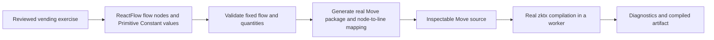

# Low-Code Learning — High-Level Design

**Status:** Full exercise proposed; the UI-only Storybook increment is implemented and locally checked, not a verified full exercise.

**Representative exercise:** [Feral Data vending machine](EXAMPLE_EXERCISE.md).

**Implementation design:** [FRONTEND_ARCHITECTURE.md](FRONTEND_ARCHITECTURE.md).

## 1. Goal: build a mental model

Teach that high-level concepts expressed through low-code nodes break down into **real Sui Move source**, which is then **compiled**. Deployment to a testnet is a future step, not part of initial completion.

The learner should be able to explain:

1. What each node means in the vending-machine example.
2. Which generated Move lines implement that concept.
3. How changing a node's configuration changes those lines.
4. What compilation checks, and why compilation is different from execution or deployment.

The learning loop is:

> Understand the offer → configure nodes → inspect their Move code → change a quantity → inspect the changed code → compile that exact source.

This supports the program's [low-code learning scope](../scope.md#pillar-1--agentic-coding-and-low-code-for-eve-frontier). It does not require a working vending service, wallet connection, or game integration.

This lesson belongs to Pillar 1's low-code track: First Move teaches Move concepts, while low-code lessons teach broader EVE Frontier patterns through node-based composition. This exercise assumes no prior Move knowledge and is cross-linked with First Move in both directions.

## 2. Representative exercise

Use a **Feral Data → EU-40 vending machine** as the concrete story: a player supplies a configured amount of Feral Data to a Smart Storage Unit and receives a small configured amount of EU-40.

The **Execution flow** is fixed:

```text
Exchange
  → Accept exact Feral Data payment
  → Dispense exact EU-40 reward
  → Complete exchange
```

Learners author **Value connections** from **Primitive Constant** outputs to quantity inputs without changing the Execution flow. One copyable `u64` output may supply both inputs; each input has at most one source and disconnecting does not substitute a default. Payment and reward quantities for the full exercise remain editable positive whole numbers set through **Primitive Constant** nodes — `Type` + `Value`, with `Type` restricted to `u64` in this version of the exercise and the node outputting only that value. Item identifiers, labels, and the Smart Storage Unit reference are locked, labelled fixtures supplied by the exercise definition; no live entity discovery, storage inventory, or real assets are required, and fixture identifiers must never be presented as verified deployed objects. Item identities are expected to become typed on-chain data in the v1 world, but that is not yet implemented; deriving item data on-chain belongs to the future testnet lesson.

The Exchange node represents explicit invocation. It must not teach that an ordinary in-game deposit automatically executes a reward callback. The inspected contract baseline does not establish that callback.

[EXAMPLE_EXERCISE.md](EXAMPLE_EXERCISE.md) defines the learner journey and acceptance checks. This document defines the design boundary; the front-end architecture explains how to deliver it.

### UI-only preview increment

The local [low-code Storybook previews](../../web/components/low-code/README.md) demonstrate typed nodes, learner-editable Value connections and tracing a shared Primitive Constant into one declaration and multiple quantity uses. Start with fixed-name CONSTANT_A and CONSTANT_B independently wired; disconnect and rewire to discover reuse. The execution spine is this same fixed Execution flow, not editable value wiring.

This increment accepts the primitive's full `u64` range, including zero; the full exercise still requires positive payment/reward quantities. Its small Move example is explicitly illustrative, uncompiled and not the vending contract. Source correspondence is limited to constants and Accept/Dispense quantity uses; it does not claim contract generation or source mapping for Exchange/Complete exchange. Any invalid displayed constant (even unused) or missing input withholds source.

Commands, limitations and [actual local validation](../../web/components/low-code/VALIDATION.md) are recorded separately from section 4 acceptance. No wallet, compiler, inventory enforcement or deployment was added. The finalised contract snapshot remains a prerequisite for the full exercise, not for these UI previews.

## 3. Minimum system



Use ReactFlow for visual authoring and zktx.io's `@zktx.io/sui-move-builder` for real compilation. Align the remaining stack with this repository: Next.js, React, TypeScript, Tailwind, Node.js, and pnpm. The exercise is delivered inside the programme website in [`web/`](../web/); its route is defined by the course structure and is intentionally not prescribed here.

One reviewed generation template and a fixed set of node kinds — Exchange, Accept Feral Data, Dispense EU-40, Complete exchange, and Primitive Constant — are sufficient. Do not build a general graph compiler, capability registry, plugin system, or multiple execution backends.

### Code must explain the nodes

Selecting a node highlights or navigates to its generated Move lines. Explain shared scaffolding separately: imports, function signatures, and resource/request handling need not correspond one-to-one with visible nodes. Clearly distinguish the client invocation control from the Move entry/function it would invoke.

Node configuration must affect meaningful generated logic or configuration consumed by that logic—not merely comments, labels, or unused constants. Generate a complete compilable package, not pseudocode or TypeScript SDK calls dressed as Move. A reviewed template must make the payment and reward rules understandable without pretending that client code performs on-chain enforcement.

### Compile the source the learner sees

Build the current generated source with pinned compiler/dependency inputs — a **vendored, fully offline snapshot of the v1 world contracts** (see section 6) — and report actual compiler diagnostics and compiled module output. Do not substitute a mock result, a canned success message, or a precompiled package.

A semantic edit invalidates the previous build result. Moving a node on the canvas does not. When the flow is invalid, mark any retained source as stale rather than showing it as the current program.

Compilation demonstrates that the generated program satisfies the compiler's checks against the selected dependencies. It does **not** prove correct economics, successful execution, deployed ABI compatibility, or a working game integration.

Before the exercise can be called ready, a real browser build of the generated package against the vendored snapshot must succeed in a production build, and the UI must state the snapshot identity (contracts commit and `sui-move-builder` version). If browser compilation proves too slow, the accepted behaviour is an honest timeout with an actionable message — never a remote compiler fallback or a substituted result.

## 4. Initial acceptance

Initial completion requires all of the following:

- The learner can select each conceptual node and identify its corresponding source region.
- Changing payment or reward quantity changes the relevant generated Move, without unrelated layout changes altering the program.
- The current valid generated package builds with the real zktx compiler against the vendored v1 world snapshot, and the UI states the snapshot identity.
- Invalid configuration and compiler failures produce actionable feedback, never a false success.
- The UI distinguishes generated source, a current successful build, and code that has not been deployed.
- The learning loop works without a wallet, RPC connection, live inventory, or testnet transaction once compiler/source assets are available.

Gates: unit tests for the pure template/validation/mapping code (vitest); a Node-side integration check that runs the real compiler against the snapshot; and a Playwright end-to-end browser check (against the production build) covering node/source navigation, constant changes, current-versus-stale output, and a real compiler build. Template tests must check the generated rules, not just that arbitrary code compiles. Deployment or successful exchange is not an initial acceptance gate.

## 5. Future testnet extension—not initial work

A later phase can take the compiled program to a testnet and connect the story to actual inventory operations, including deriving item identities on-chain once they are typed data in the v1 world (expected, not yet implemented). That phase must explicitly verify what is published and executed; the initial application should state **“Built, not deployed”**, not choose between multiple live execution strategies.

Retain these constraints for that future work:

- The v1 model is `Entity → Component → Action → Request → Requirement`; target inventory component IDs, not just “Smart Storage Unit” labels.
- Payment and reward must execute atomically, with all requests completed, Item results consumed, and borrowed capabilities returned. Never split payment and reward to work around integration limitations.
- Exact quantities and access rules must be enforced on-chain. Owner configuration authority is distinct from public player invocation.
- Verify wallet support, package/type identities, effective owner/admin actions, docking/proof integration, and compatibility with the baseline's single docking-establishment constraint before enabling transactions.

These are future execution requirements and useful context for reviewing generated source, not reasons to implement discovery, transaction builders, or wallet UI now. Portable hosting, game embedding, autonomous triggers, and broader operation catalogues remain out of scope.

## 6. Relevant contract evidence

The prior source-inspection baseline was `world-contracts/dev` at `d2027030ac168faa3da86dbaedd17c1f2d0a3845`. It is historical reference evidence only. The actual compilation target is a **vendored snapshot of the v1 world contracts revision** — currently in design, branching from the `dev` tree, and expected to move before implementation starts. That finalised revision is a **blocking prerequisite** for full exercise generation/compilation implementation; UI-only previews do not satisfy or remove it. The snapshot vendors the minimal source closure with a checked-in manifest (source repo, commit, per-file SHA-256); a checked-in script refreshes it from a pinned commit and the result is committed in a reviewed change. Runtime and CI never fetch — they verify manifest hashes only — and the UI must identify the target honestly. The documents specify the template's behaviour and obligations, not its Move syntax; the reviewed template is authored at implementation time against the finalised revision.

- [Entity/actions and locking](https://github.com/evefrontier/world-contracts/blob/d2027030ac168faa3da86dbaedd17c1f2d0a3845/contracts/core/sources/entity.move) and [request lifecycle](https://github.com/evefrontier/world-contracts/blob/d2027030ac168faa3da86dbaedd17c1f2d0a3845/contracts/core/sources/request.move).
- [Inventory requirements and handlers](https://github.com/evefrontier/world-contracts/blob/d2027030ac168faa3da86dbaedd17c1f2d0a3845/contracts/inventory/sources/inventory.move) and [reference inventory swap](https://github.com/evefrontier/world-contracts/blob/d2027030ac168faa3da86dbaedd17c1f2d0a3845/sdk/world-sdk/src/__integration__/inventory-swap.test.ts).
- [Capabilities](https://github.com/evefrontier/world-contracts/blob/d2027030ac168faa3da86dbaedd17c1f2d0a3845/contracts/core/sources/services/access_cap.move) and [docking/scratchpad](https://github.com/evefrontier/world-contracts/blob/d2027030ac168faa3da86dbaedd17c1f2d0a3845/contracts/core/sources/services/docking.move).

Legacy gate/turret designs, event dispatchers, unrelated components, and a general operations catalogue are deliberately omitted: they do not help deliver this learning loop.
